# Campus Resit Portal Database Design

This document describes the database schema represented by the Laravel migrations in `database/migrations`. It is a design reference for the current codebase, not a claim that every listed workflow is finished in the application.

## 1. Design overview

The application uses a relational MySQL schema. The `users` table is shared by Students, Administrators, and Chief Examiners, with the `role` column distinguishing account types. Students register for courses; registrations carry the payment and review status. Exams belong to courses, timetables schedule exams or courses, and results attach to a student's registration. Staff invitation and account-status history tables support staff provisioning and auditing.

The migrations also contain form-based resit and supplementary application tables. These coexist with the normalized `registrations` workflow and should be reviewed with the project team before further development so that overlapping submission records do not become competing sources of truth.

## 2. Tables and key columns

### `users`

- `id` — primary key.
- `full_name`, `email` — account identity; `email` is unique.
- `email_verified_at` — nullable verification timestamp.
- `pending_email` — nullable unique email awaiting confirmation.
- `email_verification_code_hash`, `email_verification_expires_at`, `email_verification_attempts` — verification PIN state.
- `password`, `remember_token` — authentication fields.
- `role` — `student`, `chief_examiner`, or `admin`.
- `is_active` — account activation state.
- `student_id_number` — nullable unique index number, used by student accounts.
- `phone_number` — optional contact number.
- `created_at`, `updated_at` — timestamps.

### `courses`

- `id` — primary key; `course_code` is unique.
- `course_name`, `credit_hours`, `level`, `semester` — course details. `level` and `semester` are nullable in the later migration.
- `registration_fee`, `registration_start`, `registration_deadline`, `is_active` — fee and availability fields.
- `created_at`, `updated_at` — timestamps.

### `registrations`

- `id` — primary key.
- `user_id` — student account; deletes cascade from `users`.
- `course_id` — selected course; deletes cascade from `courses`.
- `semester`, `academic_year` — registration cycle details.
- `status` — `pending_payment`, `paid`, `approved`, or `rejected`.
- `approval_remarks`, `approved_by`, `approved_at` — review details; `approved_by` references `users` and becomes null if that account is deleted.
- Unique combination: `user_id`, `course_id`, `semester`, `academic_year`.
- `created_at`, `updated_at` — timestamps.

### `payments`

- `id` — primary key.
- `registration_id` — related registration; deletes cascade.
- `user_id` — paying account; deletes cascade.
- `transaction_reference` — unique transaction identifier.
- `amount`, `payment_method`, `phone_number`, `network` — payment details.
- `status` — `pending`, `successful`, or `failed`.
- `gateway_reference`, `gateway_response`, `paid_at` — provider response and completion data.
- Index: `user_id`, `status`.
- `created_at`, `updated_at` — timestamps.

### `exams`

- `id` — primary key; `course_id` references `courses` and cascades on deletion.
- `title`, `academic_year`, `semester` — exam identity.
- `exam_type` — `resit`, `regular`, or `supplementary_quiz`.
- `duration_minutes`, `total_marks`, `status` — exam configuration and lifecycle.
- `created_at`, `updated_at` — timestamps.

### `timetables`

- `id` — primary key.
- `exam_id` — optional exam reference; cascades on deletion.
- `course_id` — course reference; cascades on deletion.
- `academic_year`, `semester`, `exam_date`, `start_time`, `end_time`, `venue`, `seating_capacity` — schedule details.
- `status` — `draft` or `published`.
- `published_by` — optional user reference; becomes null if the user is deleted.
- `published_at`, `created_at`, `updated_at` — publication and record timestamps.
- Index: `venue`, `exam_date`.

### `results`

- `id` — primary key.
- `registration_id` — student registration; cascades on deletion.
- `exam_id` — optional exam reference; cascades on deletion.
- `score`, `grade`, `remarks` — result information.
- `is_published`, `published_at` — publication state.
- `entered_by` — optional user reference; becomes null if the user is deleted.
- Unique combination: `registration_id`, `exam_id`.
- `created_at`, `updated_at` — timestamps.

### `staff_invitations`

- `id` — primary key.
- `email`, `role` — invitee and assigned staff role (`admin` or `chief_examiner`).
- `token_hash` — unique invitation token hash.
- `expires_at`, `used_at`, `revoked_at` — invitation lifecycle.
- `created_by`, `accepted_user_id` — optional references to `users`; both become null if the referenced user is deleted.
- Index: `email`, `role`.
- `created_at`, `updated_at` — timestamps.

### `account_status_histories`

- `id` — primary key.
- `user_id` — account whose status changed; deletes cascade.
- `changed_by` — optional actor in `users`; becomes null if the actor is deleted.
- `previous_status`, `new_status` — old and new active state.
- Index: `user_id`, `created_at`.
- `created_at`, `updated_at` — timestamps.

### `supplementary_cycles`

- `id` — primary key.
- `name`, `registration_starts_at`, `registration_ends_at`, `student_access_ends_at` — cycle dates and label.
- `is_current`, `is_open` — cycle flags (`is_open` is added by a later migration).
- `created_at`, `updated_at` — timestamps.

### `broadcast_messages`

- `id` — primary key.
- `title`, `message`, `category`, `is_active`, `emails_sent_count` — notice content and delivery state.
- `created_by` — optional `users` reference; becomes null if the user is deleted.
- `created_at`, `updated_at` — timestamps.

### Additional submission tables

- `resit_requests`: a user-linked form record with student/course-entry details, exam type, uploaded report/letter paths, and approval status. `user_id` cascades on user deletion.
- `supplementary_applications`: a user-linked application with status and optional medical report/letter paths. `user_id` cascades on user deletion.
- `resit_form_submissions`: a user-linked form submission with exam type, student/course details, paper count, and optional uploaded report/letter paths. `user_id` cascades on user deletion.

### Password recovery and framework tables

- `password_reset_tokens`: `email` primary key, hashed reset `token`, `attempts`, and nullable `created_at`.
- Laravel infrastructure migrations create `cache`, `cache_locks`, `jobs`, `job_batches`, and `failed_jobs`. They are omitted from the business ERD below because they support framework operations rather than portal records.

## 3. Entity relationship diagram

```mermaid
erDiagram
    USERS {
        bigint id PK
        string full_name
        string email UK
        timestamp email_verified_at
        string pending_email UK
        string email_verification_code_hash UK
        timestamp email_verification_expires_at
        tinyint email_verification_attempts
        string password
        enum role
        boolean is_active
        string student_id_number UK
        string phone_number
    }

    COURSES {
        bigint id PK
        string course_code UK
        string course_name
        tinyint credit_hours
        smallint level "nullable"
        string semester "nullable"
        decimal registration_fee
        boolean is_active
    }

    REGISTRATIONS {
        bigint id PK
        bigint user_id FK
        bigint course_id FK
        string semester
        string academic_year
        enum status
        bigint approved_by FK "nullable"
        timestamp approved_at
    }

    PAYMENTS {
        bigint id PK
        bigint registration_id FK
        bigint user_id FK
        string transaction_reference UK
        decimal amount
        enum status
        timestamp paid_at
    }

    EXAMS {
        bigint id PK
        bigint course_id FK
        string title
        string academic_year
        string semester
        enum exam_type
        enum status
    }

    TIMETABLES {
        bigint id PK
        bigint exam_id FK "nullable"
        bigint course_id FK
        date exam_date
        time start_time
        time end_time
        string venue
        enum status
        bigint published_by FK "nullable"
    }

    RESULTS {
        bigint id PK
        bigint registration_id FK
        bigint exam_id FK "nullable"
        decimal score "nullable"
        string grade "nullable"
        boolean is_published
        bigint entered_by FK "nullable"
    }

    STAFF_INVITATIONS {
        bigint id PK
        string email
        enum role
        string token_hash UK
        bigint created_by FK "nullable"
        bigint accepted_user_id FK "nullable"
        timestamp expires_at
        timestamp used_at
        timestamp revoked_at
    }

    ACCOUNT_STATUS_HISTORIES {
        bigint id PK
        bigint user_id FK
        bigint changed_by FK "nullable"
        boolean previous_status "nullable"
        boolean new_status
        timestamp created_at
    }

    SUPPLEMENTARY_CYCLES {
        bigint id PK
        string name
        datetime registration_starts_at
        datetime registration_ends_at
        datetime student_access_ends_at
        boolean is_current
        boolean is_open
    }

    BROADCAST_MESSAGES {
        bigint id PK
        string title
        text message
        string category
        bigint created_by FK "nullable"
        boolean is_active
    }

    RESIT_REQUESTS {
        bigint id PK
        bigint user_id FK
        string index_number
        json course_entries
        enum exam_type
        enum status
    }

    SUPPLEMENTARY_APPLICATIONS {
        bigint id PK
        bigint user_id FK
        string status
        string medical_report
        string letter
    }

    RESIT_FORM_SUBMISSIONS {
        bigint id PK
        bigint user_id FK
        enum exam_type
        string index_number
        int number_of_papers
        text course_details
    }

    PASSWORD_RESET_TOKENS {
        string email PK
        string token
        tinyint attempts
        timestamp created_at
    }

    USERS ||--o{ REGISTRATIONS : makes
    COURSES ||--o{ REGISTRATIONS : selected_for
    USERS o|--o{ REGISTRATIONS : approves
    REGISTRATIONS ||--o{ PAYMENTS : has
    USERS ||--o{ PAYMENTS : pays
    COURSES ||--o{ EXAMS : has
    EXAMS o|--o{ TIMETABLES : scheduled_in
    COURSES ||--o{ TIMETABLES : scheduled_for
    USERS o|--o{ TIMETABLES : publishes
    REGISTRATIONS ||--o{ RESULTS : receives
    EXAMS o|--o{ RESULTS : assesses
    USERS o|--o{ RESULTS : enters
    USERS o|--o{ STAFF_INVITATIONS : issues
    USERS o|--o{ STAFF_INVITATIONS : accepts
    USERS ||--o{ ACCOUNT_STATUS_HISTORIES : has_status_history
    USERS o|--o{ ACCOUNT_STATUS_HISTORIES : changes_status
    USERS o|--o{ BROADCAST_MESSAGES : creates
    USERS ||--o{ RESIT_REQUESTS : submits
    USERS ||--o{ SUPPLEMENTARY_APPLICATIONS : submits
    USERS ||--o{ RESIT_FORM_SUBMISSIONS : submits
```

## 4. Schema notes to resolve

1. The application has a `SupplementaryApplicationItem` Eloquent model, but the migrations currently contain no migration creating its table. It is therefore excluded from the ERD; add/confirm its migration before relying on that relationship.
2. `payments` stores both `registration_id` and `user_id`. The database does not enforce that the payment's user is the same user who owns the referenced registration; the application must validate this, or the schema should be simplified to derive the payer through `registration_id`.
3. Both `resit_requests` and `resit_form_submissions` store similar form data, while `registrations` is a separate course-registration workflow. Confirm which submission model is authoritative before expanding related features.
4. `supplementary_cycles` has both `is_current` and `is_open`; document the distinct meaning of each in the cycle workflow and ensure only one current cycle is allowed if that is the intended rule.
5. `results` permits a nullable `exam_id` while using a unique key on (`registration_id`, `exam_id`). MySQL permits multiple rows with a null value in a unique key, so the database does not guarantee only one result per registration when `exam_id` is null.

